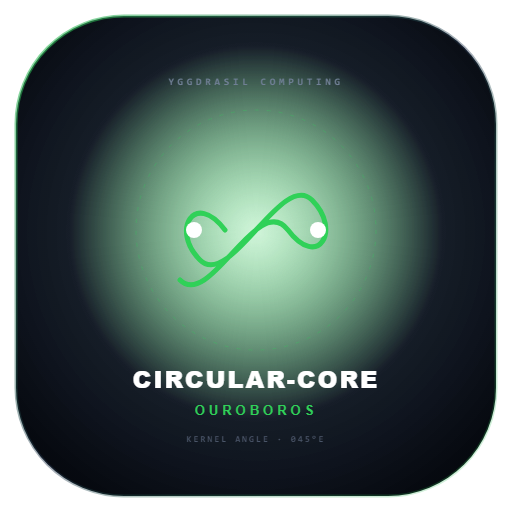
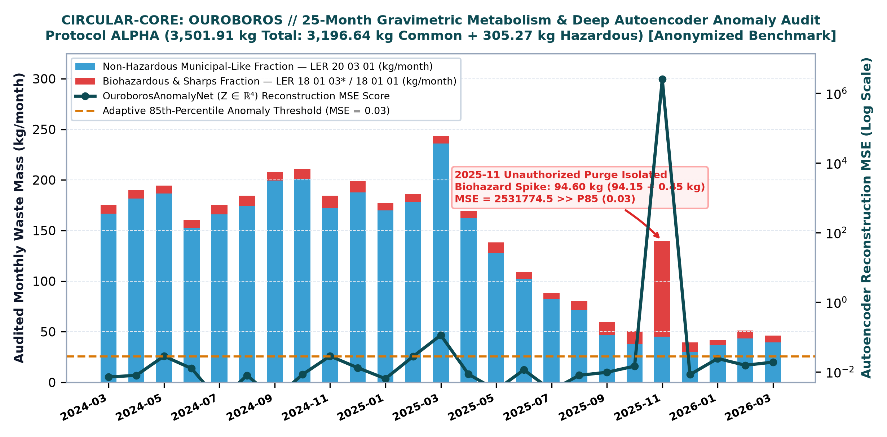
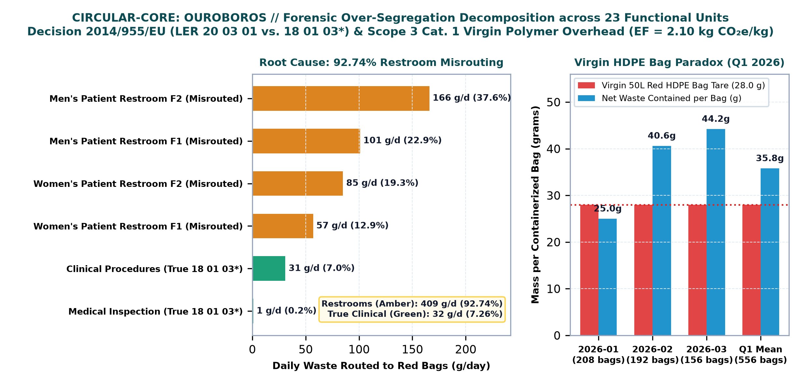
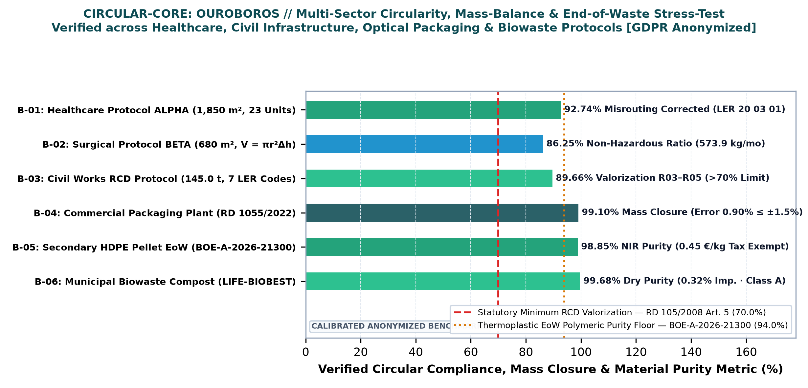
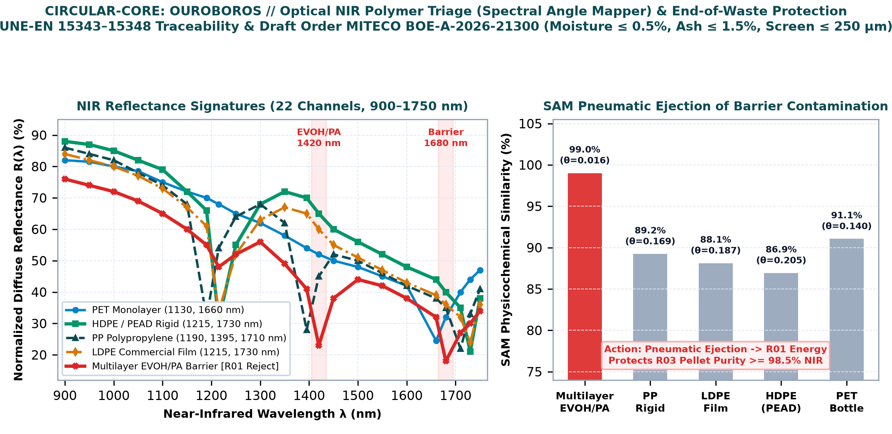
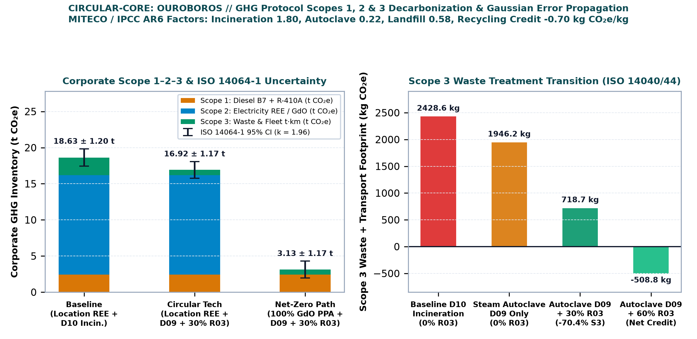
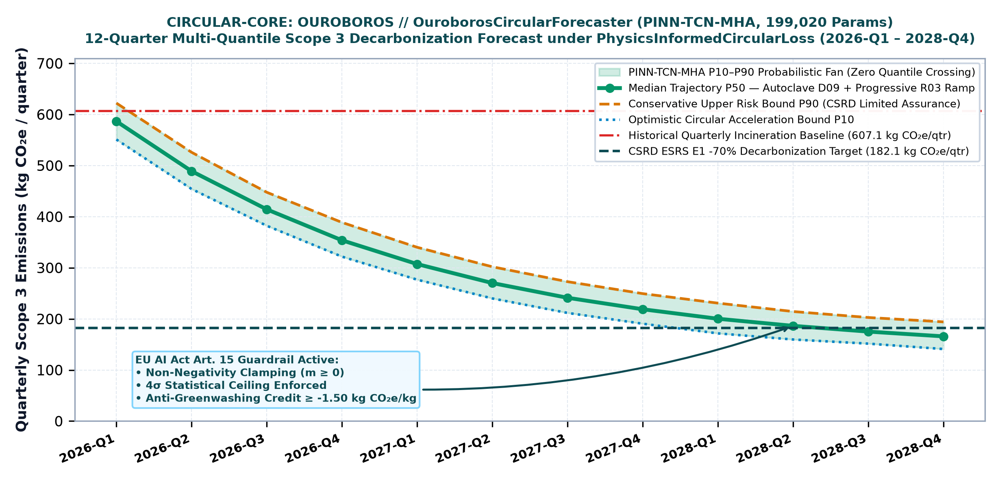

<div align="center">

  

  # CIRCULAR-CORE: OUROBOROS
  ### Gemelo Digital Ciberfísico de Metabolismo Material, Contabilidad Gravimétrica EWC/LER, Metrología Polimérica NIR y Descarbonización Multicuantil Scope 1–2–3 (PINN-TCN)

  [](https://doi.org/10.5281/zenodo.24114014)
  [](https://www.python.org/)
  [-EE4C2C.svg?style=flat-square&logo=pytorch)](https://pytorch.org/)
  [](https://www.iso.org/)
  [%20%26%20Ley%207%2F2022-00D2FF.svg?style=flat-square)](https://www.boe.es/eli/es/l/2022/04/08/7)
  [](https://www.boe.es/eli/es/rd/2022/12/27/1055)
  [](LICENSE)
  [](https://creativecommons.org/licenses/by-nc-sa/4.0/)
  [](https://www.linkedin.com/company/yggdrasil-environmental-systems)

  <br/>

  **Autor y Dirección Técnica:**  
  **Kelvin Jesús Flores Yarihuaman**  
  *Ingeniero Ambiental | Máster Universitario Oficial en Ingeniería y Gestión Ambiental (MECES Nivel 3 · EQF Level 7)*  
  *Yggdrasil Environmental Systems · Ingeniería Ambiental, Economía Circular y Descarbonización Industrial*

</div>

---

> ### ⚖️ Principio Rector del Sistema (Regla Número 0):
> *"Jamás le vamos a poder ganar a la naturaleza, ni a la biología humana; quien no entienda esto, jamás podrá vivir."*  
> — **Kelvin Jesús Flores Yarihuaman**, Fundador y Director Técnico de Yggdrasil Environmental Systems.  
>  
> *La ingeniería computacional, la metrología espectroscópica y las redes neuronales informadas por la física tienen como propósito comprender las leyes biofísicas, estequiométricas y termodinámicas del entorno, asegurando que el metabolismo material humano cierre sus ciclos respetando la conservación de la masa y la resiliencia de la biosfera.*

---

## ♻️ Resumen Ejecutivo y Alcance Científico (Edición Open-Core)

**CIRCULAR-CORE: OUROBOROS (Edición Open-Core V1.0)** es una plataforma ciberfísica de **Análisis de Flujo de Materiales (MFA, ISO 59020:2024)**, contabilidad gravimétrica y volumétrica de residuos según la **Lista Europea de Residuos (LER, Decisión 2014/955/UE)**, triaje óptico polimérico en el infrarrojo cercano (**NIR**) y cuantificación de **Huella de Carbono Corporativa (Alcances 1, 2 y 3 bajo UNE-EN ISO 14064-1:2019 e ISO 14040/44)**. Concebida como Sistema de Soporte a la Decisión (DSS) bajo supervisión humana (**Art. 14 y Art. 15 del Reglamento UE 2024/1689 — EU AI Act**), la edición pública integra cinco pilares científico-técnicos reproducibles:

1. **Contabilidad de Carbono Alcances 1, 2 y 3 con Propagación Gaussiana de Incertidumbre (`ISO 14064-1:2019`):** Cuantificación acoplada de combustión estacionaria y fugas refrigerantes IPCC AR6 (Alcance 1), contabilidad dual eléctrica *Location-Based* REE vs. *Market-Based* 100% Garantías de Origen (Alcance 2) y Análisis de Ciclo de Vida de fin de vida de residuos (Alcance 3 Categorías 1, 4 y 5: incineración `D10`, esterilización por vapor en autoclave `D09`, vertedero `D01` y crédito circular por reciclaje mecánico `R03`).
2. **Metabolismo Gravimétrico, Árbol de Decisión MITECO (`HP 1–HP 15`) y Calidad de Biorresiduos (`LIFE-BIOBEST`):** Auditoría de series temporales gravimétricas reales, aforo volumétrico cilíndrico in situ ($V = \pi r^2 \Delta h$), clasificación estequiométrica de códigos LER espejo bajo el **Reglamento (UE) 1357/2014** y **Reglamento (UE) 2017/997 (HP 14 Ecotóxico)**, y auditoría agronómica de compost (Clases A/B/C según **RD 506/2013** y directrices europeas **LIFE-BIOBEST**).
3. **Diagnóstico Forense de Causa Raíz: La Paradoja de Sobre-Segregación en Aseos (`92,74%`) y Bolsas Vírgenes HDPE:** Descomposición empírica en 23 unidades funcionales que demuestra cómo el `92,74%` del flujo clasificado erróneamente como biorriesgo peligroso (`LER 18 01 03*`) en centros ambulatorios proviene de papel higiénico y toallas secamanos de 4 aseos de pacientes (asimilables a urbanos `LER 20 03 01`), revelando además que en el Q1 2026 la tara de la bolsa virgen de PEAD (`28,0 g`) igualó prácticamente al residuo neto contenido (`35,8 g`).
4. **Espectroscopía NIR (`OUROBOROS SPECTRA`) y Certificación de Fin de Condición de Residuo (`End-of-Waste`):** Discriminación óptica en 22 longitudes de onda (`900–1750 nm`) mediante el algoritmo **Spectral Angle Mapper (SAM)** para separar resinas monomateriales (`PET`, `PEAD/HDPE`, `PP`, `LDPE`) de filmes multicapa con barrera `EVOH/PA`, acoplado al cierre de balance de masa en planta ($\le \pm 1,50\%$ bajo **RD 1055/2022**) y certificación de granza secundaria conforme a **UNE-EN 15343–15348** y **Orden MITECO BOE-A-2026-21300**.
5. **Laboratorio Neuronal Dual en PyTorch (`neural_lab/models.py`) y Doble Armadura Criptográfica (`ATHENA` + `ASTRAEA`):** Empareja el autoencoder no supervisado **`OuroborosAnomalyNet`** (`1.964` parámetros, cuello de botella latente $Z \in \mathbb{R}^4$, latencia `0,40 ms`) para aislar purgas anómalas de almacén con el predictor multicuantil **`OuroborosCircularForecaster`** (`199.020` parámetros, `WaveNet TCN` causal dilatada + `BiGRU` + `Cross-Attention` de 4 cabezas, latencia `3,87 ms`) entrenado bajo **`PhysicsInformedCircularLoss`**.

<div align="center">
  
  <p><em>Figura 1. Serie gravimétrica auditada de 25 meses (Protocolo ALPHA: 3.501,91 kg totales en 23 unidades) y aislamiento automático del pico anómalo de noviembre de 2025 (94,60 kg) mediante el error de reconstrucción MSE de OuroborosAnomalyNet.</em></p>
</div>

---

## ⚡ Rendimiento Computacional y Métricas Auditadas (Ground-Truth)

| Indicador Técnico / Metrológico | Contabilidad Convencional (Facturas Post-Hoc) | IA de Caja Negra sin Restricciones | CIRCULAR-CORE: OUROBOROS (Open-Core V1.0) |
| :--- | :--- | :--- | :--- |
| **Latencia de Inferencia Dual-AI (CPU)** | Días / Semanas (Cierre mensual manual) | `< 10 ms` | **`< 4 ms` (`0,40 ms` AE + `3,87 ms` PINN-TCN)** |
| **Cierre de Balance de Masa (`EN 45501`)** | Sin verificación de tara ni humedad | Viola conservación ($\Delta m \neq 0$) | **Error $\le 0,5\%$ en báscula · $\le \pm 1,50\%$ planta (`RD 1055/2022`)** |
| **Causa Raíz de Sobre-Segregación** | Invisible en albaranes agregados | No distingue origen clínico vs. aseos | **`92,74%` aislado en 4 aseos (`0,409 kg/día` `LER 20 03 01`)** |
| **Abatimiento Auditado de Alcance 3** | Línea base incineración `D10` (`2.428,6 kg CO2e`) | Riesgo de *greenwashing* algorítmico | **`-70,4%` (`718,7 kg CO2e` con Autoclave `D09` + `30% R03`)** |
| **Huella Corporativa (`ISO 14064-1`, $k=1,96$)** | Sin propagación de incertidumbre | Sin cotas físicas ni intervalos CI 95% | **`18,63 ± 1,20 t CO2e` ➔ `3,13 ± 1,17 t CO2e` (`-83,2%` Market-Based)** |
| **Gobernanza Normativa y Física** | Revisión documental fragmentada | Incumple `EU AI Act Art. 15` | **`134` normas `ASTRAEA` + `4` invariantes físicas `ATHENA` (SHA-256)** |

---

## 📊 Galería Científica y Diagnósticos Forenses (300 DPI)

<div align="center">
  <h3>1. Descomposición Forense de la Paradoja de los Aseos (92,74%) e Ineficiencia de Bolsa Virgen HDPE</h3>
  
  <br/><br/>

  <h3>2. Benchmark Multisectorial Anonimizado (Sanitario, Quirúrgico, Obra Civil RCD, Envases, Granza EoW y Compost)</h3>
  
  <br/><br/>

  <h3>3. Espectroscopía NIR (Spectral Angle Mapper) y Eyección Neumática de Multicapas EVOH/PA</h3>
  
  <br/><br/>

  <h3>4. Inventario Corporativo UNE-EN ISO 14064-1:2019 y Abatimiento Tecnológico de Alcance 3 (-70,4%)</h3>
  
  <br/><br/>

  <h3>5. Pronóstico Probabilístico Multicuantil a 12 Trimestres (OuroborosCircularForecaster PINN-TCN)</h3>
  
</div>

---

## 🏛️ Fundamentación Físico-Matemática de los Motores Open-Core

### 1. ⚖️ Continuidad Gravimétrica Dinámica (`ISO 59020:2024`) y Volumetría Cilíndrica
* Conservación estricta de masa en nodos de triaje y tratamiento con tolerancia de báscula Clase III ($\le 0,5\%$ según **EN 45501**) y corrección psicrométrica de Dulong-Boie para el poder calorífico inferior ($LHV_{\text{ar}}$):
  $$\sum m_{\text{in}}(t) = \sum m_{\text{R03–R05}}(t) + \sum m_{\text{D01–D10}}(t) + m_{\text{evap}}(t) + \Delta S, \qquad V = \pi \left(\frac{d}{2}\right)^2 \Delta h$$

### 2. 🌍 Contabilidad Alcances 1–2–3 e Incertidumbre Expandida (`UNE-EN ISO 14064-1:2019`)
* Integración de factores estequiométricos MITECO / IPCC AR6 (incineración `1,80`, autoclave `0,22`, vertedero `0,58` y crédito por reciclaje mecánico `-0,70 kg CO2e/kg`), logística rodada en $t\cdot\text{km}$ (`0,190 kg CO2e/(t·km)`) y propagación cuadrática de incertidumbre al 95% ($k = 1,96$):
  $$E_{\text{S3}} = \sum_{k} m_k \cdot EF_k + \sum_{k} (m_k \cdot L_k) \cdot EF_{t\cdot\text{km}}, \qquad U_{95} = 1,96 \sqrt{\sum_{i} \left(E_i \cdot u_i\right)^2}$$

### 3. 🔬 Triaje Óptico NIR (`Spectral Angle Mapper`) y Ecotoxicidad `HP 14` (`Reg. UE 2017/997`)
* Discriminación angular en espacio reflectivo de 22 canales ($\mathbb{R}^{22}$, `900–1750 nm`) e índice estequiométrico ponderado para clasificación de residuos espejo peligrosos:
  $$\theta_{\text{SAM}}(\mathbf{u}, \mathbf{v}) = \arccos\left(\frac{\mathbf{u} \cdot \mathbf{v}}{\|\mathbf{u}\| \, \|\mathbf{v}\|}\right), \qquad I_{\text{HP14}} = 100 \sum c(\text{H410}) + 10 \sum c(\text{H411}) + \sum c(\text{H412}) \ge 25\%$$

### 4. 🧠 Pérdida Compuesta Multicuantil Informada por la Física (`PhysicsInformedCircularLoss`)
* `OuroborosCircularForecaster` optimiza simultáneamente la pérdida Pinball asimétrica para los cuantiles $q \in \{0,10; 0,50; 0,90\}$ junto con penalizaciones exactas por cruce cuantil, masas negativas y desacoplamiento estequiométrico masa-emisión:
  $$\mathcal{L}_{\text{PINN}} = \mathcal{L}_{\text{pinball}} + 1,5\,\text{ReLU}(P_{10} - P_{50}) + 1,5\,\text{ReLU}(P_{50} - P_{90}) + 2,0\,\text{ReLU}(-\hat{y}) + 0,5\,\mathcal{L}_{\text{ratio}}$$

---

## 🛡️ Doble Armadura de ADN (`ATHENA` + `ASTRAEA`)

Para garantizar que la edición pública sea 100% auditable y autosuficiente en cualquier entorno (local, Docker, GitHub o Streamlit Cloud) hasta el corte Open-Core, el repositorio incorpora dos cápsulas maestras selladas con **SHA-256**:

1. **Cápsula de ADN Regulatorio (`compliance/regulatory_dna.json` + `auto_verificador_integridad.py`):** Generada por **VERI-AUDIT: ASTRAEA**, codifica **134 normas verificadas** (`81` España BOE, `28` Unión Europea DOUE y `25` Internacionales ISO/UNE-EN) con **0% de fugas jurisdiccionales ajenas a UE/España**, sellada bajo **ISO/IEC 27037**.
2. **Cápsula de ADN Físico-Científico (`physics/scientific_dna.json` + `sentinel_sidecar.py`):** Generada por **AI-CORE: ATHENA**, codifica **4 invariantes físicas inviolables** (`INV_OURO_01` a `INV_OURO_04`), **6 límites de acotación termodinámica (*clamping*)** y **12 referencias científicas internacionales *peer-reviewed***.

---

## 🚀 Instalación y Ejecución Local

### 1. Clonar el repositorio e instalar dependencias
```bash
git clone https://github.com/Yggdrasil-Environmental-Systems/CIRCULAR-CORE-OUROBOROS.git
cd CIRCULAR-CORE-OUROBOROS
pip install -r requirements.txt
```

### 2. Verificar integridad criptográfica de las cápsulas y ejecutar pruebas unitarias
```bash
python compliance/auto_verificador_integridad.py
python -m unittest discover -s tests -p "test_*.py"
```

### 3. Iniciar la consola interactiva Open-Core
```bash
streamlit run app.py
```

---

## 📂 Estructura del Repositorio Open-Core

```text
CIRCULAR-CORE-OUROBOROS/
├── app.py                                               # Consola principal Streamlit Open-Core
├── huggingface_space/app.py                             # Espejo de despliegue para Cloud / Spaces
├── requirements.txt                                     # Dependencias (Streamlit, PyTorch, Plotly, NumPy, Pandas)
├── CITATION.cff                                         # Metadatos oficiales de citación científica (DOI Zenodo)
├── LICENSE                                              # Licencia pública GNU GPLv3
├── WHITE_PAPER_CIRCULAR_CORE_OUROBOROS_OPEN_CORE.pdf    # White Paper científico oficial (8 páginas A4, DOI Zenodo)
├── app/
│   ├── components/                                      # Tarjetas KPI, gráficos Plotly y componentes FREYJA UI
│   └── styles/theme.css                                 # Hoja de estilos Obsidian Void
├── assets/                                              # Iconografía y emblemas oficiales del núcleo
├── paper_figures/                                       # Figuras científicas de alta resolución (300 DPI) y QR DOI
├── configs/
│   └── factores_emision_oficiales.json                  # Factores oficiales MITECO 2026, REE e IPCC AR6
├── core/
│   ├── catalogo_ler.py                                  # Catálogo Europeo de Residuos (Decisión 2014/955/UE)
│   ├── gravimetria.py                                   # Balances gravimétricos, volumetría y paradoja de aseos
│   ├── scope1_direct_engine.py                          # Alcance 1: Combustión estacionaria y gases fluorados AR6
│   ├── scope2_electricity_engine.py                     # Alcance 2: Location-Based (REE) vs. Market-Based (GdO)
│   ├── scope3_waste_engine.py                           # Alcance 3: Tratamiento D10/D09/D01/R03, t·km y bolsas HDPE
│   ├── acv_iso14040.py                                  # Análisis de Ciclo de Vida (ISO 14040 / ISO 14044)
│   ├── huella_carbono_iso14064.py                       # Inventario corporativo e incertidumbre (ISO 14064-1:2019)
│   ├── clasificador_ler_miteco.py                       # Clasificador de residuos espejo HP 1–HP 15 (Reg. 2017/997)
│   ├── control_calidad_biorresiduos_biobest.py          # Auditoría de compost Clases A/B/C (RD 506/2013 & LIFE-BIOBEST)
│   ├── envases_rd1055_rap.py                            # Triaje óptico NIR SAM, balance RD 1055/2022 y certificación EoW
│   └── ai_guardrails.py                                 # Salvaguardas anti-alucinación y anti-greenwashing (EU AI Act)
├── neural_lab/
│   └── models.py                                        # OuroborosAnomalyNet (1.964p) & OuroborosCircularForecaster (199.020p)
├── physics/
│   ├── scientific_dna.json                              # Cápsula ATHENA (4 invariantes físicas y 12 referencias)
│   └── sentinel_sidecar.py                              # Centinela físico en tiempo de ejecución
├── compliance/
│   ├── regulatory_dna.json                              # Cápsula ASTRAEA (134 normas BOE, DOUE e ISO/UNE-EN)
│   └── auto_verificador_integridad.py                   # Verificador criptográfico SHA-256 standalone
├── data/                                                # Protocolos de calibración anonimizados (GDPR / ISO 27001)
│   ├── healthcare_facility_alpha.json                   # Protocolo ALPHA (25 meses, 3.501,91 kg, 23 unidades)
│   ├── healthcare_facility_beta.json                    # Protocolo BETA (Quirúrgico / Dental, 573,9 kg/mes)
│   └── civil_works_rcd.json                             # Obra Civil RCD (145,0 t, 7 fracciones LER)
└── tests/                                               # Suite de pruebas unitarias Open-Core
    ├── test_clasificador_ler_biobest.py
    ├── test_envases_rd1055.py
    └── test_huella_carbono_iso14064.py
```

---

## 📖 Citación Científica y DOI Permanente (CERN / Zenodo)

Si utilizas **CIRCULAR-CORE: OUROBOROS**, sus motores gravimétricos y de ACV, el clasificador NIR o las arquitecturas PyTorch `OuroborosAnomalyNet` y `OuroborosCircularForecaster` en publicaciones académicas, auditorías de economía circular o inventarios de huella de carbono, cita el depósito permanente en **CERN / Zenodo**:

```bibtex
@software{flores_yarihuaman_ouroboros_2026,
  author       = {Flores Yarihuaman, Kelvin Jesús},
  title        = {{CIRCULAR-CORE: OUROBOROS — Cyberphysical Material Metabolism Digital Twin, EWC/LER Gravimetric Accounting, Near-Infrared Polymer Metrology & Physics-Informed Multi-Quantile Scope 1–2–3 Decarbonization Platform}},
  year         = {2026},
  version      = {1.0.0-open-core},
  publisher    = {Zenodo / CERN},
  doi          = {10.5281/zenodo.24114014},
  url          = {https://doi.org/10.5281/zenodo.24114014},
  note         = {Yggdrasil Environmental Systems · Environmental Engineer | Master's Degree in Environmental Engineering and Management (MECES Nivel 3 / EQF Level 7)}
}
```

---

## ⚖️ Marco Legal, Aviso de Anonimización y Licenciamiento Tri-Modular

* **Aviso de Benchmarks Anonimizados (GDPR / ISO 27001):** Todos los identificadores de centros, códigos NIMA de ejemplo, lotes de clasificación de envases y ensayos de compost incluidos en `data/` constituyen **protocolos de calibración anonimizados y sintéticos** diseñados exclusivamente para validar los motores matemáticos, espectroscópicos y normativos de `CIRCULAR-CORE: OUROBOROS`. No representan actas de inspección oficiales ni auditorías comerciales de ningún hospital público, ayuntamiento u operador privado nominal.
* **Supervisión Humana (Art. 14 EU AI Act — Reglamento UE 2024/1689):** La plataforma opera como Sistema de Soporte a la Decisión (DSS). Sus resultados no sustituyen las declaraciones oficiales ante **eSIR / MITECO** ni la verificación acreditada por **ENAC**.

### 📜 Esquema de Licenciamiento (Open-Core vs. Enterprise Suite)

1. **💻 Código Fuente Open-Core y Arquitecturas Base PyTorch:** Distribuido bajo **[GNU General Public License v3.0 (GPLv3)](LICENSE)**.
2. **📄 White Paper Científico y Formulación Técnica (`WHITE_PAPER_CIRCULAR_CORE_OUROBOROS_OPEN_CORE.pdf`):** Distribuido bajo **[Creative Commons Attribution-NonCommercial-ShareAlike 4.0 International (CC BY-NC-SA 4.0)](https://creativecommons.org/licenses/by-nc-sa/4.0/)**.
3. **🏢 Edición Enterprise Suite (B2B / G2B — Licencia Comercial Propietaria):** Los pesos industriales preentrenados en GPU NVIDIA L4 (**`OuroborosDeepLatentAE`** `276.120p` y **`OuroborosDeepPINNForecaster`** `1.518.718p`), el motor de liquidación tributaria de la **Ley 7/2022** (canon de vertedero/incineración e impuesto al plástico), el exportador telemático **E3L v3.0 XML para eSIR (RD 764/2026 y Orden TED/1024/2026)**, los certificados de liberación de fianza municipal de obra civil RCD (**RD 105/2008**) y el generador de tablas **CSRD ESRS E1/E5 Big 4** son propiedad exclusiva de **Yggdrasil Environmental Systems** y no forman parte de este repositorio público.
